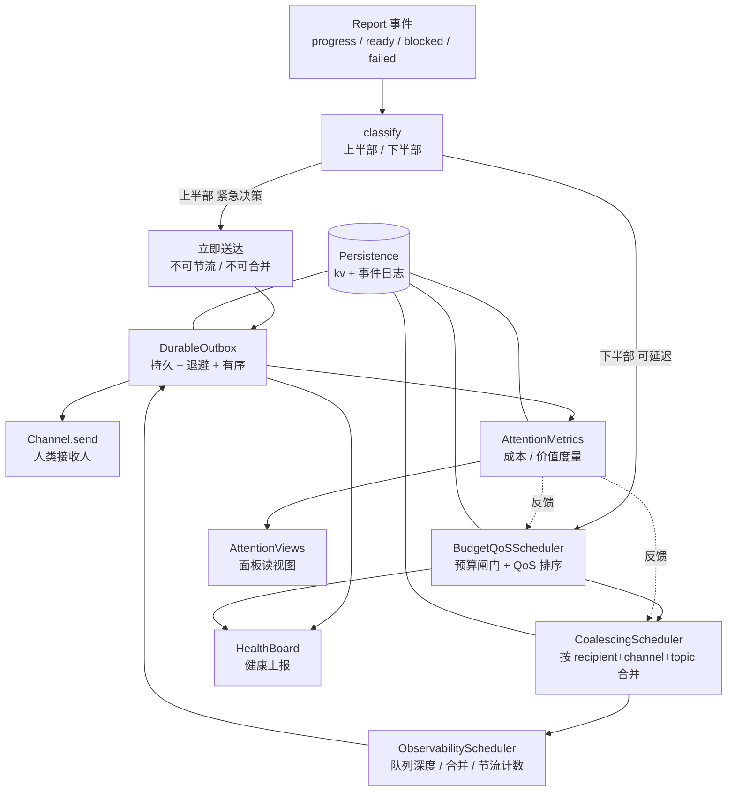
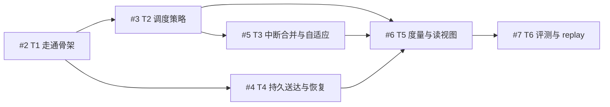

# osagentic

**注意力中断调度子系统（Attention IRQ Subsystem）**——把操作系统中断子系统的思想用于 LLM agent 系统，将「人类注意力」建模为可调度、可预算、可度量、可恢复的稀缺资源。

> 核心命题来自 DeepSeek Harness 团队的 Super-agent 设计：**人类注意力是新的瓶颈**（human attention is the new bottleneck）。一个能为整个团队行动的 agent，也可能浪费整个团队的注意力。osagentic 用 OS 中断管理的成熟理论（threaded IRQ、adaptive coalescing、QoS 调度、cgroups 配额、journaling、checkpoint/restore）来回答：agent 应当何时、以何种形式、向谁打断人类，以及如何在崩溃后不丢失、不重复地恢复。

- 许可证：MIT
- 语言：TypeScript（ESM / NodeNext，严格模式）
- 运行时：Node.js ≥ 24
- 包管理：pnpm
- 测试：vitest（10 个测试文件，80 个测试，全部在 Source/Channel 边界 seam）

---

## 目录

- [背景与动机](#背景与动机)
- [设计概览](#设计概览)
- [OS 机制对照](#os-机制对照)
- [核心概念](#核心概念)
- [模块参考](#模块参考)
- [快速开始](#快速开始)
- [用法示例](#用法示例)
- [配置参考](#配置参考)
- [端口与适配器](#端口与适配器)
- [持久化与恢复](#持久化与恢复)
- [测试](#测试)
- [评测与 replay](#评测与-replay)
- [项目结构](#项目结构)
- [开发工作流](#开发工作流)
- [范围与边界](#范围与边界)
- [参考](#参考)

---

## 背景与动机

### 从操作系统到 agent

把 LLM agent 系统类比为操作系统时，许多基础设施问题会自然浮现：agent 会话相当于进程，上下文窗口相当于物理内存，工具调用相当于系统调用，多 agent 协作相当于 IPC。本仓库聚焦其中一个被忽视的子系统——**中断管理**。

在 OS 中，中断是稀缺资源：网卡每秒可能产生数万个中断，若每个都立即打断 CPU，系统会被中断风暴淹没。于是有了 interrupt coalescing（合并）、threaded IRQ（上半部/下半部分离）、QoS 调度、cgroups 配额、interrupt throttling。

agent 系统面临同构的问题：多个 Executor 并发产出 progress / ready / blocked / failed 报告，若每条都立即推送给人类，团队成员会被碎片化通知频繁打断，高价值紧急决策反而被低价值通知淹没。

### 与 dsh-superagent 的关系

[DeepSeek Harness 团队的 dsh-superagent](https://github.com/deepseek-ai/dsh-superagent-prototype)（MIT）已经实现了一个相当完整的 OS 式 agent 内核：事务性 Engine、持久化 Effects 队列、每 Ticket 独立 Session 与目录、WorkerSlots、Mandate 授权、Source 驱动模型、Outbox 事务性发件箱。它的核心原则是「消耗尽可能少的人类注意力，给出尽可能多的价值」，但注意力管理目前是启发式规则（问题立即转发、进展留在 Ticket、turn 内 relay 合并到下一步）。

osagentic 把这些启发式规则提升为**有理论支撑、可度量、可优化的调度子系统**。边界端口（Source / Channel / Outbox / Store / Clock / Effects / Scheduler / Metrics）镜像 dsh-superagent 的接口，领域词汇沿用之（Report / Attention / Ticket / Mandate / Outbox / Effects / Source / Channel）。

完整 spec 见 [`specs/attention-irq-subsystem.md`](specs/attention-irq-subsystem.md)（GitHub issue #1）；OS × agent 机制对照调研见 [`docs/os-agent-systems.md`](docs/os-agent-systems.md)。

---

## 设计概览

整个子系统是一条中断处理流水线，测试与扩展都在唯一的 **Source/Channel 外部边界** seam 进行：



关键不变量：

- **上半部紧急中断（blocked/failed 等待人工输入）永远立即送达**，预算耗尽也不节流、不合并、不延迟。这是正确性约束，误抑制率必须为零。
- **下半部中断（progress/ready/notice）** 经预算闸门、QoS 排序、合并窗口后才送达。
- **所有状态变更经 Persistence 持久化**，重启后恢复待决队列、合并组、预算账本、送达队列与度量，幂等无重复。
- **送达有序**：同一 Ticket 同一会话，acknowledgement 先于 answer/result。

---

## OS 机制对照

| OS 机制 | osagentic 对应 | 模块 |
|---|---|---|
| threaded IRQ（上半部/下半部） | 紧急决策立即送达 / 可延迟通知排队 | `domain.classify` |
| cgroups CPU 配额 / NIC interrupt budget | 个人 + 团队注意力预算（次数 + 成本，滑动窗口） | `budget` |
| QoS I/O 调度（mq-deadline / BFQ） | priority + deadline + 加权 value/cost 排序 | `scheduler` |
| NIC adaptive interrupt coalescing / timer slack | 按 recipient+channel+topic 合并，负载/延迟/价值自适应窗口 | `coalesce` |
| interrupt throttling | 预算耗尽节流下半部，窗口滚动恢复补发 | `scheduler` |
| transactional outbox / journaling / workqueue | 先持久化再 send，指数退避，持久副作用队列 | `outbox` / `effects` |
| CRIU checkpoint/restore | 重启恢复待决队列与合并组，幂等无重复 | `scheduler` / `coalesce` / `outbox` |
| interrupt masking | 暂停抑制送达，截止时间按暂停时长顺延 | `pause` |
| /proc 健康 / watchdog | 调度器与送达队列健康条目（deadline-miss / stuck-retry） | `health` |
| /proc/interrupts 计数 | 注意力成本/价值度量、队列深度、合并/节流统计 | `metrics` / `observability` / `views` |
| event sourcing / journal replay | 从持久事件重建送达流，输入轨迹重放 | `replay` |
| WAL | Persistence 事件日志（判别联合 DomainEvent） | `persistence` / `domain` |

---

## 核心概念

### IRQ（中断请求）

每个需要人类介入的 Report 经 `toIrq` 转为一个 IRQ，携带 `half`（top/bottom）、`recipient`、`channel`、`topic`、`value`（产出价值估计）、`cost`（注意力成本估计）、`priority`、`deadline`、`links`（可追溯链接）。

- **上半部（top）**：`blocked` / `failed` 等待人工输入，恒为上半部，立即送达。
- **下半部（bottom）**：`progress` / `ready`，可延迟、可合并、可节流。
- `waiting` / `dropped` 不产生中断。

### 注意力预算（Attention Budget）

滑动窗口配额，限制每个接收人在窗口内的中断**次数**与**成本**。团队成员额外共享团队聚合配额；个人与团队闸门均须通过。账本经 Persistence 持久化，窗口外记录自动清理。上半部与到期补发无条件计费，不受闸门限制。

### QoS 排序

下半部按 `priority` 降序 → 有效 `deadline` 升序（无 deadline 视为无穷远）→ 加权 `value/cost` 降序；完全同序保持提交顺序（稳定排序）。权重 = `1 + valuePriorityWeight × 接收人累计产出价值`，高价值产出者同等条件下优先。

### 合并与自适应（Coalescing）

同一 recipient+channel+topic 的下半部消息在时间窗内聚合为一条摘要（`irqIds` 含全部成员、`links` 为并集、`text` 逐行列出事项）。窗口自适应：

```
window = clamp(windowMs + growthMs × (load − 1) + latencyWeight × 平均响应延迟 − valueWeight × 累计价值, 保底, maxWindowMs)
```

负载越高窗口越宽；响应越慢越适合批量送达（窗口宽）；历史价值越高越早送达（窗口窄）。上半部不参与合并。

### 持久送达与恢复（Durable Outbox）

先持久化 DeliveryRecord 与 `delivery.enqueued` 事件，再 `Channel.send`；成功写 receipt（`delivery.sent`）。`waiting` / `gone` / 抛错均指数退避重试。同一 Ticket 同一会话有序（前序未送达则后序等待）。Source 关闭（`gone`）等待而非丢弃。重启从 Persistence 重建待决队列，剔除已 sent 残留，enqueue 对已送达消息幂等忽略。消息 ID 用 `randomUUID`，跨重启唯一，避免幂等检查误判。

### 暂停（Pause）

`PauseState` 记录累计暂停时长。暂停期间抑制送达；恢复后待决中断的截止时间按暂停时长顺延。暂停属有意抑制，HealthBoard 不报故障。

### 度量与读视图（Metrics / Views）

每次送达按 `message.irqIds` 汇总成本与价值，按接收人累计次数/成本/价值/打断时机，经 Persistence 持久化。`AttentionMetrics` 同时实现 `AttentionFeedback`，提供接收人平均响应延迟与累计价值，供调度器与合并层自适应。`AttentionViews.panel(now)` 返回剩余预算、队列深度、合并/节流计数、成本/价值汇总与 `valueExceedsCost` 判定。

### 健康（HealthBoard）

最小健康注册表。调度器条目报告待决数与截止时间漏判（deadline-miss）；送达队列条目报告待决数与重试停滞（stuck-retry）。暂停期间不误报。

---

## 模块参考

| 模块 | 职责 |
|---|---|
| `domain.ts` | 领域类型（Report/Irq/Message/DeliveryRecord/DeliveryMetric）、判别联合 DomainEvent、classify/toIrq/messageOf、nextId（randomUUID） |
| `ports.ts` | 端口接口：Clock / Channel / Persistence / Scheduler / Outbox / Metrics / AttentionFeedback |
| `runtime.ts` | 组合根 `createRuntime` / `Runtime`（ingest/flush/pause/resume）；默认 ImmediateScheduler / SimpleOutbox / NoopMetrics |
| `clock.ts` | SystemClock（Date.now）/ ManualClock（advance/set，测试用） |
| `persistence.ts` | InMemoryPersistence（kv + 事件日志） |
| `pause.ts` | PauseState（pause/resume/isPaused/pausedMs） |
| `budget.ts` | AttentionBudget 账本、BudgetLimits / TeamBudgetLimits、windowUsage |
| `scheduler.ts` | BudgetQoSScheduler（预算闸门 + QoS + 策略版本化 + 队列持久化 + 健康） |
| `coalesce.ts` | CoalescingScheduler（自适应合并 + 合并组持久化 + bufferedIrqIds） |
| `observability.ts` | ObservabilityScheduler（队列深度 / 合并 / 节流计数，区分缓冲与节流） |
| `effects.ts` | EffectsQueue（持久副作用队列，FIFO 分组 + 指数退避） |
| `outbox.ts` | DurableOutbox（持久送达 + 退避 + 有序 + 度量挂钩 + 健康）、deliveryKey |
| `metrics.ts` | AttentionMetrics（度量 + 反馈）、irqIndexOf / irqOf 共享索引 |
| `views.ts` | AttentionViews（面板读视图） |
| `health.ts` | HealthBoard / HealthEntry |
| `replay.ts` | deliveryStreamOf / snapshotsOf / TraceRecorder / replayTrace |
| `eval.ts` | generateWorkload / attentionScheduler / runVariant / compareAB |

---

## 快速开始

```bash
pnpm install        # 安装依赖
pnpm typecheck      # tsc --noEmit
pnpm test           # vitest run
pnpm check          # typecheck + test（80 个测试）
```

无运行时外部依赖（仅开发依赖 typescript / vitest / @types/node）。Persistence 默认内存实现；接入真实存储只需实现 `Persistence` 端口。

---

## 用法示例

### 最小走通骨架

```ts
import { createRuntime } from './src/runtime.js';
import { SystemClock } from './src/clock.js';
import { InMemoryPersistence } from './src/persistence.js';
import type { Channel, Message, SendResult } from './src/ports.js';

// Channel 是接入真实通信渠道（GitHub / Feishu / Slack 等）的适配器
const channel: Channel = {
  send(message: Message): SendResult {
    console.log(`→ ${message.recipient}: ${message.text}`);
    return 'sent';
  },
};

const runtime = createRuntime({
  clock: new SystemClock(),
  channel,
  persistence: new InMemoryPersistence(),
});

// 上半部紧急中断：立即送达
runtime.ingest({
  ticketId: 't1',
  kind: 'blocked',
  recipient: 'alice',
  channel: 'chat-1',
  question: 'Which design should we use?',
  at: Date.now(),
});
```

### 完整调度器栈

```ts
import { createRuntime } from './src/runtime.js';
import { SystemClock } from './src/clock.js';
import { InMemoryPersistence } from './src/persistence.js';
import { PauseState } from './src/pause.js';
import { BudgetQoSScheduler, type BudgetQoSConfig } from './src/scheduler.js';
import { CoalescingScheduler } from './src/coalesce.js';
import { ObservabilityScheduler } from './src/observability.js';
import { DurableOutbox } from './src/outbox.js';
import { AttentionMetrics } from './src/metrics.js';
import { AttentionViews } from './src/views.js';
import { HealthBoard } from './src/health.js';

const clock = new SystemClock();
const persistence = new InMemoryPersistence();
const pause = new PauseState();
const health = new HealthBoard();
const metrics = new AttentionMetrics({ persistence });

const budget: BudgetQoSConfig = {
  version: 1,
  windowMs: 60_000,
  maxInterrupts: 20,
  maxCost: 100,
  recipients: { alice: { windowMs: 60_000, maxInterrupts: 10, maxCost: 50 } },
  teams: { core: { windowMs: 60_000, maxInterrupts: 30, maxCost: 150, members: ['alice', 'bob'] } },
  valuePriorityWeight: 0.1,
};

// 可观测性 包裹 合并 包裹 预算 QoS；metrics 同时作为反馈来源
const scheduler = new ObservabilityScheduler(
  { persistence },
  new CoalescingScheduler(
    new BudgetQoSScheduler({ persistence, pause, health }, budget, metrics),
    { windowMs: 1000, growthMs: 250, maxWindowMs: 8000, latencyWeight: 0.5, valueWeight: 0.01 },
    persistence,
    metrics,
  ),
);

const outbox = new DurableOutbox({ clock, channel, persistence, pause, metrics, health });
const runtime = createRuntime({ clock, channel, persistence, pause, scheduler, outbox, metrics });

runtime.ingest({ ticketId: 't1', kind: 'progress', recipient: 'alice', channel: 'chat-1', at: clock.now(), value: 3, cost: 1 });

// 策略版本化：变更配额后待决中断按新策略重评
scheduler.applyPolicy({ ...budget, version: 2, maxInterrupts: 30 });

// 面板读视图
const panel = new AttentionViews(persistence, budget).panel(clock.now());
console.log(panel.totals, panel.valueExceedsCost, panel.queueDepth, panel.coalesced, panel.throttled);
console.log(health.entries(clock.now()));
```

### 边界测试（createHarness）

```ts
import { createHarness } from './test/harness.js';
import { BudgetQoSScheduler } from './src/scheduler.js';
import { AttentionMetrics } from './src/metrics.js';
import { AttentionViews } from './src/views.js';

const config = { windowMs: 1000, maxInterrupts: 2, maxCost: 10 };
const h = createHarness({
  scheduler: (d) => new BudgetQoSScheduler(d, config),
  metrics: (d) => new AttentionMetrics(d),
});

h.report({ ticketId: 't1', kind: 'progress', recipient: 'alice', channel: 'chat-1', at: 0, value: 3, cost: 1 });
h.advance(1000);                       // 推进 ManualClock 并 flush 到期送达
console.log(h.channel.sent());         // 观察外部送达

const panel = new AttentionViews(h.persistence, config).panel(h.clock.now());
```

`createHarness(opts)` 返回 `{ clock, channel, persistence, pause, runtime, report(r), advance(ms), pauseNow(), resumeNow() }`。`opts.scheduler / outbox / metrics` 是工厂 `(deps: HarnessDeps) => 实现`，`HarnessDeps = { clock, channel, persistence, pause }`。

---

## 配置参考

### BudgetQoSConfig（extends BudgetLimits）

| 字段 | 类型 | 说明 |
|---|---|---|
| `windowMs` | number | 滑动窗口长度（毫秒） |
| `maxInterrupts` | number | 每窗口中断次数上限 |
| `maxCost` | number | 每窗口注意力成本上限 |
| `version` | number? | 策略版本；经 `applyPolicy` 变更触发待决重评 |
| `recipients` | Record<Recipient, BudgetLimits>? | 特定接收人独立配额 |
| `teams` | Record<string, TeamBudgetLimits>? | 团队聚合配额 |
| `valuePriorityWeight` | number? | 历史价值放大优先级权重系数（默认 0.1） |

`TeamBudgetLimits extends BudgetLimits` 增加 `members: Recipient[]`。

### CoalesceConfig

| 字段 | 默认 | 说明 |
|---|---|---|
| `windowMs` | 1000 | 基础合并窗口 |
| `growthMs` | 250 | 每多一个待决下半部，窗口增加量 |
| `maxWindowMs` | 8000 | 窗口上限（高负载下延迟有界） |
| `latencyWeight` | 0 | 响应延迟放大窗口系数 |
| `valueWeight` | 0 | 历史价值缩减窗口系数 |

### OutboxOptions

| 字段 | 说明 |
|---|---|
| `storageKey` | 送达队列存储键 |
| `baseDelayMs` | 退避基础延迟 |
| `backoffFactor` | 退避倍率 |

---

## 端口与适配器

子系统通过端口与外部解耦。接入真实环境只需实现这些接口：

```ts
interface Clock { now(): number }
interface Channel { send(message: Message): 'sent' | 'gone' | 'waiting' }
interface Persistence {
  load<T>(key: string): T | undefined;
  save<T>(key: string, value: T): void;
  append(event: DomainEvent): void;
  log(): DomainEvent[];
}
interface Scheduler { submit(irq: Irq): void; due(now: number): Message[]; bufferedIrqIds?(): string[] }
interface Outbox { enqueue(message: Message): void; drain(now: number): void }
interface Metrics { recordDelivery(message: Message, now: number): void }
interface AttentionFeedback { feedbackFor(recipient: Recipient): RecipientFeedback | undefined }
```

- **Channel**：接入 GitHub comment / Feishu reply / Slack 等。返回 `waiting`（暂时失败，退避重试）、`gone`（Source 关闭，等待恢复）、`sent`（成功）。
- **Persistence**：默认 `InMemoryPersistence`；生产可换 SQLite / Postgres 适配器（kv + append-only 事件日志）。
- **Clock**：生产用 `SystemClock`，测试用 `ManualClock`。
- **Scheduler / Outbox / Metrics**：可替换或包裹（装饰器模式），无需改动核心。

---

## 持久化与恢复

所有状态经 `Persistence` 持久化，重启后由各模块构造时加载恢复：

| 存储键 | 内容 | 恢复方 |
|---|---|---|
| `attention-budget:ledger` | 个人计费记录 | AttentionBudget |
| `attention-budget:team-ledger` | 团队计费记录 | AttentionBudget |
| `attention-scheduler:pending` | 上半部/下半部待决队列 | BudgetQoSScheduler |
| `attention-coalesce:groups` | 合并组 + irq 主题映射 + 缓冲计数 | CoalescingScheduler |
| `attention-metrics:deliveries` | 单次送达度量 | AttentionMetrics |
| `attention-metrics:recipients` | 接收人累计度量 | AttentionMetrics |
| `attention-obs:queue-depth` / `:coalesced` / `:throttled` | 可观测性计数 | ObservabilityScheduler |
| `delivery:<messageId>` | 送达记录 / receipt | DurableOutbox |

恢复语义：

- 消息 ID 用 `randomUUID`，跨进程重启唯一；DurableOutbox 幂等检查不会把新消息误判为已送达。
- 重启剔除 receipt 已 sent 的残留队列条目，待决送达恢复后不重复送达。
- `PauseState` 不持久化；恢复的中断以当前暂停时长为顺延基线。
- 事件日志（判别联合 `DomainEvent`：`irq.created` / `delivery.enqueued` / `delivery.sent` / `irq.delivered` / `delivery.coalesced`）支撑 replay 与度量。

---

## 测试

唯一测试 seam：**Source/Channel 外部边界**。测试只断言外部送达行为（人类收到什么、何时、如何聚合、什么被抑制），不断言内部结构。

- 装置：`test/harness.ts` 的 `createHarness`（fake Source 注入 Report、RecordingChannel 记录送达、ManualClock 驱动时序）。
- TDD：先红后绿、垂直切片。
- 正确性约束作为测试断言：上半部误抑制率为零、送达有序、恢复幂等。

| 测试文件 | 覆盖 |
|---|---|
| `skeleton.test.ts` | 走通骨架、分类、立即送达 |
| `pause.test.ts` | 暂停抑制与时长累计 |
| `budget-scheduler.test.ts` | 预算节流/恢复、QoS 排序、上半部免节流、独立计费、持久化、到期补发、暂停顺延 |
| `coalesce.test.ts` | 合并摘要、链接并集、自适应窗口、有序保持、上半部不合并 |
| `durable-outbox.test.ts` | 退避重试、有序、Source 关闭等待、暂停顺延、重启幂等（含崩溃窗口） |
| `metrics-views.test.ts` | 成本/价值度量、剩余预算、队列深度、合并/节流计数、重启可读 |
| `eval.test.ts` | replay 三方相等、多 Executor 负载、A/B 对比、误抑制率为零 |

运行 `pnpm check`：typecheck + 80 个测试。

---

## 评测与 replay

### A/B 评测

```ts
import { generateWorkload, compareAB, type EvalConfig, type RunFactory } from './src/eval.js';
import { createHarness } from './test/harness.js';

const trace = generateWorkload({
  executors: [
    { ticketId: 'task-a', recipient: 'alice', channel: 'chat-alice', value: 8, cost: 2 },
    { ticketId: 'task-b', recipient: 'alice', channel: 'chat-alice', value: 5, cost: 1 },
    { ticketId: 'task-c', recipient: 'bob', channel: 'chat-bob', value: 6, cost: 2 },
    { ticketId: 'task-d', recipient: 'bob', channel: 'chat-bob', value: 9, cost: 1 },
  ],
  reportsPerExecutor: 10,
  horizonMs: 20_000,
  seed: 7,
  drainMs: 50_000,
  drainStepMs: 1000,
});

const config: EvalConfig = {
  budget: { windowMs: 10_000, maxInterrupts: 4, maxCost: 40 },
  coalesce: { windowMs: 2000 },
};

const runFactory: RunFactory = (opts) =>
  createHarness({
    scheduler: opts.scheduler ? (d) => opts.scheduler!(d) : undefined,
    metrics: opts.metrics ? (d) => opts.metrics!(d) : undefined,
  });

const ab = compareAB(trace, config, runFactory);
console.log(ab.heuristic.metrics.interruptCount);   // 40（全部立即）
console.log(ab.scheduler.metrics.interruptCount);   // < 40（合并 + 节流）
console.log(ab.scheduler.metrics.deliveredValue);   // 88（价值不损失）
console.log(ab.scheduler.metrics.falseSuppressionRate); // 0（上半部无误抑制）
```

`EvalMetrics` 字段：`interruptCount`、`interruptsPerRecipient`、`meanInterInterruptMs`、`deliveredValue`、`deliveredCost`、`coalescedRatio`、`throttledRatio`、`topInterrupts`、`falseSuppressionRate`、`topDecisionWaitMs`、`bottomDecisionWaitMs`、`undeliveredBottom`。

`generateWorkload` 用确定性种子（mulberry32）构造多 Executor 交错负载，每第 4 个报告为携带 question 的 blocked（上半部），末尾附空闲推进使节流中断补发。

### Replay

```ts
import { deliveryStreamOf, snapshotsOf, TraceRecorder, replayTrace } from './src/replay.js';

// 从持久事件重建历史送达流
const stream = deliveryStreamOf(persistence);
// 把边界观察到的送达规范化为同一快照形状，逐条比较
const observed = snapshotsOf(channel.sent(), persistence);

// 记录输入轨迹（Report 注入 + 时钟推进/暂停），经新 runtime 重现
const recorder = new TraceRecorder(target);
// ... recorder.report(r) / recorder.advance(ms) / recorder.pause() / recorder.resume()
replayTrace(recorder.trace(), { clock, runtime });
```

`DeliverySnapshot` 去掉过程生成 ID，用稳定身份（ticket/kind/创建时刻）表示成员中断，跨运行可比较。

---

## 项目结构

- `src/`
  - 契约：`domain.ts`、`ports.ts`、`runtime.ts`、`clock.ts`、`persistence.ts`、`pause.ts`
  - 调度：`budget.ts`、`scheduler.ts`、`coalesce.ts`、`observability.ts`
  - 送达：`effects.ts`、`outbox.ts`
  - 度量：`metrics.ts`、`views.ts`、`health.ts`
  - 评测：`replay.ts`、`eval.ts`
- `test/`
  - `harness.ts`（边界 seam 装置）
  - `skeleton` / `pause` / `budget-scheduler` / `coalesce` / `durable-outbox` / `metrics-views` / `eval` 测试
- `specs/attention-irq-subsystem.md`（spec，GitHub #1）
- `docs/os-agent-systems.md`（OS × agent 调研）
- `docs/agents/`（issue tracker / triage labels / domain docs 配置）
- `AGENTS.md`（agent skill 指引）

---

## 开发工作流

本仓库按 spec → tickets → implement → review 的流程构建：

1. **spec**：`specs/attention-irq-subsystem.md`（GitHub #1）。
2. **tickets**：六张 tracer-bullet 垂直切片（#2–#7），带阻塞关系，均已关闭。
3. **implement**：单一 integration branch `impl/attention-irq`，每个 ticket 在独立 worktree 用 TDD 构建，逐个合并。
4. **code-review**：双轴（Standards + Spec）审查，单个子 agent 修复全部发现（正确性缺陷 + spec 缺口 + Standards 重构），新增 28 个回归测试。

任务图：



---

## 范围与边界

- osagentic 是**独立子系统**，在 Source/Channel 边界 seam 实现 spec 行为；边界端口镜像 dsh-superagent 接口。
- 接入真实 dsh-superagent / DeepSeek Harness 宿主的适配器属 **out of scope**（spec 明言「不修改 DeepSeek Harness 内部」）。Channel / Persistence 适配器是接入点。
- 不调度计算资源（WorkerSlots / token 预算抢占 / 模型路由）；本子系统调度**人类注意力**。
- 安全边界 / 沙箱、Async ReAct、虚拟上下文记忆管理、跨设备进程迁移均为独立工作，不在本 spec 内。

---

## 参考

- spec：[`specs/attention-irq-subsystem.md`](specs/attention-irq-subsystem.md)（GitHub #1）
- 调研：[`docs/os-agent-systems.md`](docs/os-agent-systems.md)
- [dsh-superagent-prototype](https://github.com/deepseek-ai/dsh-superagent-prototype)（DeepSeek Harness，MIT）
- DeepSeek《Exploring Super-agent Design: Towards a More Autonomous Agent System》
- OS 概念：Linux threaded IRQ、adaptive interrupt coalescing、cgroups、mq-deadline/BFQ、CRIU、transactional outbox、event sourcing
- 相关项目：AIOS、MemGPT/Letta、MemOS、UFO²、OpenHands、e2b、kubernetes-sigs/agent-sandbox、Temporal/DBOS/Restate

## 许可证

MIT
